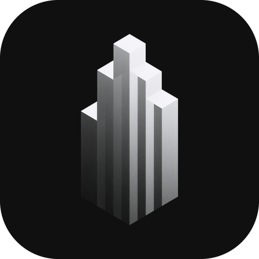

# Brand kit

## Where Arcter speaks

* **On X:** [@arcterdotxyz](https://x.com/arcterdotxyz)
* **By email:** hello@arcter.xyz
* **On the web:** [arcter.xyz](https://arcter.xyz)

Security reports go to security@arcter.xyz.

Treat any other domain or account using the name as unofficial. Arcter has no deployed programs and no public addresses, so any address offered in its name today is not genuine. Once programs ship, addresses will appear only on the website and in these docs.

## The name

Write **Arcter**: capital A, the rest lower case. Keep it out of all caps in running text.

## The mark

The mark is an isometric tower of stepped square columns. Top faces are white. Side faces fade through stippled greys into the near-black tile, which has rounded corners. The tower carries no color, and the green accent stays out of it.

<figure><figcaption>The Arcter mark on its tile</figcaption></figure>

Using it:

* Keep the tower centered on its tile. For an app icon, crop the tile square and change nothing else.
* Place the tile on any calm surface. Warm paper and white sheets both suit it.
* Leave clear space of at least 50% of the tile's width on each side.
* Do not recolor the tower, add a border, shadow or glow, or set the tile on a vivid background.
* Without the tile, the tower may only sit directly on a night surface.

## Overall look

Arcter should feel like a well-made financial instrument: quiet and exact. Pages are warm paper with ink type and white sheets on top. The real product is the main image on any page, usually the ticket itself. Illustration is not part of the system. Motion stays sparing, and it stands down for readers who prefer reduced motion.

## Palette

**Surfaces**

| Name | Value | Role |
| --- | --- | --- |
| Canvas | `#f7f6f3` | Warm paper behind every page |
| Paper | `#ffffff` | White sheets, cards and panels |
| Sunk | `#f0efeb` | Recessed tracks and muted fills |
| Hover | `#ebe9e4` | Pointer feedback on quiet surfaces |
| Night | `#0d0d0e` | The few bands that need contrast |
| Night 2 | `#17171a` | A step up within night bands |

**Ink and lines**

| Name | Value | Role |
| --- | --- | --- |
| Ink | `#121211` | Primary text and the primary button |
| Ink 2 | `#3d3c39` | Body copy |
| Ink 3 | `#66645f` | Labels and supporting text |
| Ink 4 | `#8d8a83` | Hints only |
| Line | `#e7e5df` | Hairlines between rows and sheets |
| Line strong | `#d7d4cc` | Input borders and firmer edges |

Ink, Ink 2 and Ink 3 clear WCAG AA on both canvas and paper. Ink 4 does not carry that claim, so it stays away from anything a reader must read.

**Accent**

| Name | Value | Role |
| --- | --- | --- |
| Accent | `#4ade80` | The single light green, for what is live or actionable |
| Accent strong | `#22c55e` | Hover state of accent fills |
| Accent soft | `#eafcf0` | Pale tinted backgrounds |
| Accent ink | `#166534` | Green at text weight, for links and small type |

Light green is a fill color. Small green type uses Accent ink, because the light shade does not hold up as text. Green is also the focus outline. No other accent hue exists in the system.

**Status**

| Name | Value | Role |
| --- | --- | --- |
| Up | `#15803d` | Rising values and success |
| Down | `#c13f2b` | Falling values and errors |
| Warn | `#a5630a` | Caution states |

Status colors appear only on values and states, and never as decoration.

## Type

| Face | Used for | Notes |
| --- | --- | --- |
| Instrument Serif | Display and section headlines | Regular weight, tight tracking, italics for emphasis |
| Geist | Body, controls and card titles | Card titles are semibold |
| Geist Mono | Figures, labels and code | Good for account data and identifiers |

Figures use tabular numerals, so columns line up. Small table heads and spec labels are short uppercase overlines. Everything else, headlines included, is sentence case.

## Shape and depth

Corners grow with the element.

| Element | Radius |
| --- | --- |
| Tags | 6px |
| Small buttons | 8px |
| Buttons, inputs and segmented controls | 10px |
| Large buttons | 12px |
| Dashboard panels | 14px |
| Cards | 18px |
| The one product surface a screen is built around | 20px |

Sheets get a hairline and the faintest lift. Only that central product surface takes a deep shadow. A screen has one solid ink primary button, and the green accent button is kept for the most important action inside the product.

## Writing

Language stays literal. A vault is a vault and a router is a router. Feature names, buttons and errors use no mythology or metaphor. The reader may be buying a first tokenized ETF or checking account layouts, and both deserve respect.

The working rules:

* Keep sentences short and declarative.
* Put a unit on every figure.
* Itemize costs. Reference, spread and fee stay separate.
* Link claims to Solscan or the Solana Explorer where possible.
* State risks in the main text.
* Say what is planned as planned. Nothing is called live until it is.
* Use no exclamation marks and no invented urgency.

One test for any sentence: could a skeptical auditor quote it back and make us uneasy? If so, rewrite it.
